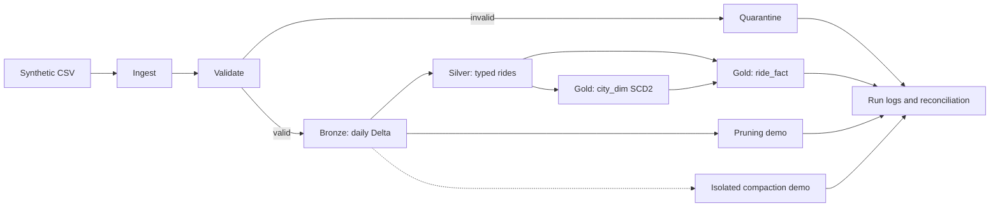
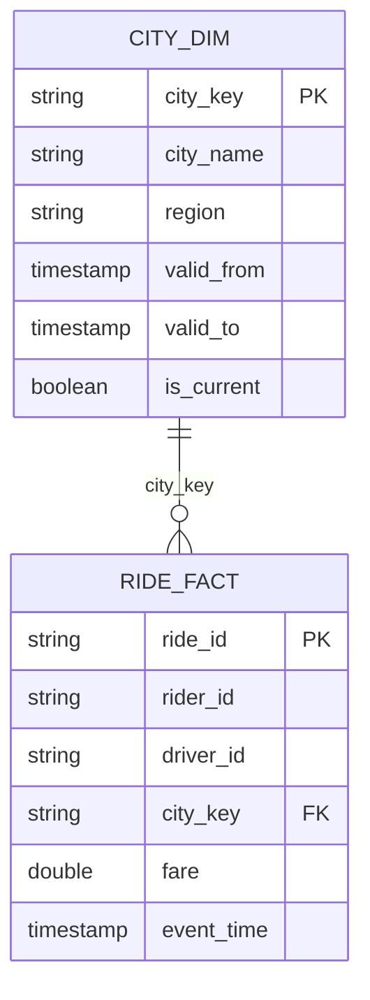

# Time-Partitioned Ride Data Lake

A local PySpark and Delta Lake pipeline for validated, date-partitioned ride analytics.

   

## Problem statement

Analytical workloads need efficient access to time-bounded ride events.
Unstructured storage can force unnecessary scans and produce excessive small files.
This project partitions events by UTC date, validates incoming records, and
demonstrates pruning, compaction, reconciliation, and safe replay.

## Architecture




## Key features

| Feature | How it is implemented |
| --- | --- |
| Daily event-time partitioning | Bronze and Silver use UTC `year/month/day` from `event_time`. |
| Partition pruning | The demo compares a full scan with a day-filtered scan and records its plan and metrics. |
| Small-file compaction | An isolated Delta OPTIMIZE demo measures active files before and after compaction. |
| Validation and quarantine | Schema and business checks separate invalid rows with reasons and source metadata. |
| Idempotent MERGE | Delta merges by `ride_id`; exact replays are ignored and conflicting payloads fail. |
| Late-arriving data | New ride IDs are routed to the partition for their event date. |
| SCD Type 2 | City region changes create effective-dated versions with stable keys. |
| Run logging | JSON logs capture run status, timing, counts, and failure reasons. |
| Reconciliation | Batch counts and fare totals are compared across pipeline layers. |

## Quick start

### Open in GitHub Codespaces

1. Create a repository with this project's files at its root.
2. Select **Code → Codespaces → Create codespace on main** and wait for setup.
3. Open the terminal and run:

   ```bash
   bash run_all.sh
   ```

The runner creates a fresh `output/runs/` directory for each execution. It generates
data, runs and reruns the pipeline, runs both demos, and executes pytest.

<details>
<summary>Manual local setup</summary>

Use Linux, macOS, or WSL2, with Python 3.10–3.12 and Java 17. The first setup and
Delta startup require network access for dependencies.

```bash
python3.11 -m venv .venv
source .venv/bin/activate
python -m pip install -r requirements.txt
bash run_all.sh
```

See [troubleshooting](docs/TROUBLESHOOTING.md) for environment and retry guidance.

</details>

## Project structure

```text
.
├── .devcontainer/devcontainer.json  # Codespaces environment
├── config.yaml                      # Paths, rules, Spark and generator settings
├── requirements.txt                 # Python dependencies
├── run_all.sh                       # Isolated end-to-end workflow
├── src/
│   ├── generate_data.py             # Synthetic records and expected counts
│   ├── ingest.py                    # CSV ingestion and provenance
│   ├── validate.py                  # Business checks and rejection reasons
│   ├── transform.py                 # Bronze, Silver, Gold and SCD2 logic
│   ├── partition_writer.py          # Delta table writes and MERGE rules
│   ├── optimize.py                  # Isolated compaction demonstration
│   ├── prune_demo.py                # Pruning and file-metric demonstration
│   └── run_pipeline.py              # Orchestration, logging and reconciliation
├── tests/test_pipeline.py           # Spark and Delta test cases
├── sample_data/                     # Starter input and expected counts
├── output/                          # Generated logs, reports and run artifacts
├── prompts/                         # AI prompt history and build prompt
└── docs/                            # Design, troubleshooting and diagrams
```

## Data model

| Column | Type | Rule |
| --- | --- | --- |
| `ride_id` | string | Required; unique per ride under the source contract. |
| `rider_id` | string | Required. |
| `driver_id` | string | Required. |
| `city` | string | Required; one of the five configured cities. |
| `fare` | numeric | Required, finite, and greater than zero; INR. |
| `event_time` | ISO-8601 timestamp | Required, timezone-aware, and not later than the run cutoff. |
| `status` | string | `completed`, `cancelled`, or `in_progress`. |



## Validation rules

| Rule | `rejection_reason` |
| --- | --- |
| Malformed CSV record | `malformed_record` |
| Missing ride, rider, or driver ID | `missing_ride_id`, `missing_rider_id`, `missing_driver_id` |
| Missing event time | `missing_event_time` |
| Invalid or future timestamp | `invalid_event_time`, `future_timestamp` |
| Missing or unsupported city | `invalid_city` |
| Missing, non-finite, or non-positive fare | `invalid_fare` |
| Missing or unsupported status | `invalid_status` |
| Duplicate valid ride ID within a batch | `duplicate_ride_id` |

The first failing rule is recorded. Unexpected headers fail the batch.

## Partitioning strategy and trade-offs

| Strategy | Pruning | File size | Best for |
| --- | --- | --- | --- |
| Daily | Strong for daily filters | Can be small at low volume | Regular date-based analytics |
| Monthly | Coarser for daily filters | Fewer, potentially larger files | Low-volume, broad-range scans |
| Hourly | Fine-grained | Higher small-file risk | High-volume hourly queries |

Daily UTC partitioning is selected for date-based queries and late-event routing.
Compaction combines eligible files within a partition, not across dates.


*The diagram is illustrative; its example file sizes and partition counts are not benchmark results.*
See [partitioning trade-offs](docs/trade_off_note.md) for details.

## Idempotency, retry and backfill

- Delta MERGE inserts unseen ride IDs; an exact replay does not add duplicates.
- Conflicting payloads for an existing ID fail rather than overwrite history.
- Retry with the same source and cutoff after inspecting the failure log.
- Backfill new ride IDs using their event dates and covered city-history intervals.
- Delta commits are per table; cross-table atomicity and concurrent writers are not supported.

## Testing

| Test | Scenario | Expected result |
| --- | --- | --- |
| Happy path | Valid ride through Gold | One fact is produced. |
| Empty input | Empty batch | No rows or target changes. |
| Malformed record | Extra CSV field | Record is quarantined. |
| Duplicate key | Repeated `ride_id` | One valid row survives. |
| Null handling | Missing event time | Row is rejected with its reason. |
| Late arrival | Historical event timestamp | Historical partition is selected. |
| Invalid reference | Unsupported city | Row is quarantined. |
| Rerun | Replay identical input | Target count does not increase. |

Additional tests cover future timestamps, schema changes, SCD2, retries, pruning,
and compaction. Execute `pytest -q` to produce current results.

## Results

*Populated from output/ after running run_all.sh.* Copy measured values from the generated reports.

| Reconciliation | Count |
| --- | ---: |
| Source / quarantine | — / — |
| Bronze / Silver / Gold batch | — / — / — |

| Pruning scan | Files with rows | On-disk bytes of those files | Time |
| --- | ---: | ---: | ---: |
| Full scan | — | — | — |
| One day | — | — | — |

| Compaction | Active files | Average file size |
| --- | ---: | ---: |
| Before | — | — |
| After | — | — |

## Known limitations and next steps

- Complete end-to-end execution and generated test evidence are required before reporting results.
- Observed file sizes are not physical I/O bytes; files emitting no rows are excluded.
- Compaction runs on an isolated demo; low-volume daily partitions may remain small.
- The source contract allows one event per ride; changed payloads and backdated city corrections are rejected.
- City validity must cover event dates; concurrent writers and cross-table recovery require additional design.
- Spark CSV parsing may not identify every malformed input pattern.

## AI usage

AI tools were used during development. The [prompt history](prompts/prompt_history.md) records available prompts.
The [build prompt](prompts/project_build_prompt.md) and completeness notes are retained for review.
