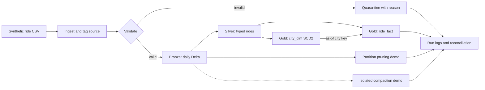
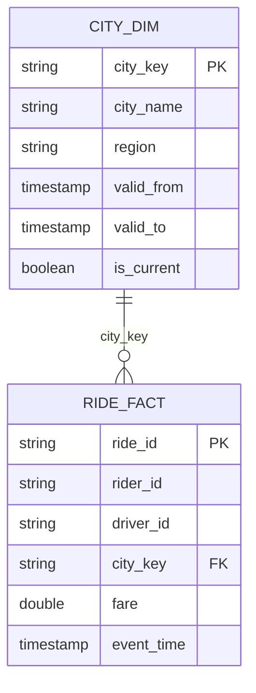

# Time-Partitioned Ride Data Lake

**A local PySpark and Delta Lake pipeline that turns raw ride events into reliable, time-partitioned analytics.**

   

[Architecture](#architecture) · [Features](#key-features) · [Quick start](#quick-start) · [Data model](#data-model) · [Results](#results)

## Problem statement

Ride analytics must answer date-based questions without scanning irrelevant data or accepting unreliable records. This project demonstrates a date-partitioned pipeline with validation, historical context, safe replay, reconciliation, and measurable pruning and compaction experiments.

## Architecture




<details>
<summary><strong>Explore: late-arriving events</strong></summary>

The isolated demonstration sends an older event in a second batch and assigns it to its **event-date** partition, not the processing date. In the recorded run, the existing `2024/2/29` partition grew from one row to two without losing the newer event.

</details>

<details>
<summary><strong>Explore: city history with SCD Type 2</strong></summary>

A controlled city-region change closes the old version and inserts a new current version. Rides join to the version valid at their event time. The example region names are synthetic.

</details>

## Key features

| Feature | Implementation |
| --- | --- |
| Daily event-time partitions | Bronze and Silver derive UTC `year/month/day` from the event timestamp. |
| Partition pruning | Full and day-filtered scans record observed files, sizes, timing and Spark plan metrics. |
| Small-file compaction | An isolated Delta `OPTIMIZE` experiment records active files before and after. |
| Validation and quarantine | Invalid records retain a reason and source/run metadata. |
| Idempotent MERGE | Exact ride replays do not add duplicates; conflicting payloads fail. |
| Late arrivals | A later batch is checked against its historical event-date partition. |
| SCD Type 2 | City-region versions retain effective intervals and historical ride mappings. |
| Run logging | Structured logs capture timestamps, counts, status and failures. |
| Reconciliation | Source, accepted and target counts plus fare totals are compared. |

## Quick start

### Open in GitHub Codespaces

1. Open the repository on GitHub and select **Code → Codespaces → Create codespace on main**.
2. Wait for the Python 3.11, Java 17 and dependency setup to finish.
3. In the Codespace terminal, run:

   ```bash
   bash run_all.sh
   ```

Each invocation creates `output/runs/run01/`, then `run02/`, and so on, containing a first execution and a replay. After success, open that run's `reports/reviewer_summary.md`. Codespaces usage and billing depend on the account's quota and settings.

<details>
<summary><strong>Manual local setup: Linux, macOS or WSL2</strong></summary>

Install Python 3.10–3.12 and Java 17, then run from the repository root:

```bash
python3.11 -m venv .venv
source .venv/bin/activate
python -m pip install -r requirements.txt
bash run_all.sh
```

Initial setup and Delta startup require network access. See [troubleshooting](docs/TROUBLESHOOTING.md).

</details>

## Project structure

```text
.
├── .devcontainer/                  # Codespaces environment
├── config.yaml                     # Paths, validation and Spark settings
├── requirements.txt                # Python dependencies
├── run_all.sh                      # Generation, pipeline, demos and tests
├── src/
│   ├── generate_data.py            # Reproducible input and injection labels
│   ├── ingest.py                   # CSV schema and source metadata
│   ├── validate.py                 # Quality checks and rejection reasons
│   ├── transform.py                # Bronze, Silver, Gold and SCD2 logic
│   ├── partition_writer.py         # Delta writes and MERGE policies
│   ├── prune_demo.py / optimize.py # Pruning and compaction measurements
│   ├── reviewer_demo.py            # Late-arrival and city-history examples
│   ├── reviewer_summary.py         # Readable report from run artifacts
│   └── run_pipeline.py             # Orchestration and reconciliation
├── tests/                          # Automated Spark and Delta checks
├── sample_data/                    # Starter input and expected counts
├── output/evidence/                # Selected, reviewed run evidence
├── prompts/                        # AI prompt history and build prompt
└── docs/                           # Data dictionary, trade-offs and diagrams
```

## Data model

**Grain:** one source record per ride under an immutable `ride_id` contract.

| Column | Type | Rule |
| --- | --- | --- |
| `ride_id` | string | Required; unique logical ride key. |
| `rider_id` | string | Required; no rider-master lookup. |
| `driver_id` | string | Required; no driver-master lookup. |
| `city` | string | Required; one of the five configured cities. |
| `fare` | numeric | Required, finite and greater than zero; INR. |
| `event_time` | ISO-8601 timestamp | Required, timezone-aware and no later than the run cutoff. |
| `status` | string | `completed`, `cancelled` or `in_progress`. |



Gold facts join city versions using `[valid_from, valid_to)` intervals. See the [data dictionary](docs/data_dictionary.md) for nullability, derived fields and reference-check assumptions.

## Validation rules

| Rule | `rejection_reason` |
| --- | --- |
| Malformed record | `malformed_record` |
| Missing ride, rider or driver ID | `missing_ride_id`, `missing_rider_id`, `missing_driver_id` |
| Missing, invalid or future event time | `missing_event_time`, `invalid_event_time`, `future_timestamp` |
| Missing or unsupported city | `invalid_city` |
| Missing, non-finite or non-positive fare | `invalid_fare` |
| Missing or unsupported status | `invalid_status` |
| Duplicate valid ride ID within a batch | `duplicate_ride_id` |

The first failing reason is retained. Unexpected headers fail the batch. Injection labels are separate from input and are not final validation decisions.

## Partitioning strategy and trade-offs

| Strategy | Pruning | File-size trade-off | Best for |
| --- | --- | --- | --- |
| **Daily** | Strong for day filters | Sparse days can produce small files | Date-based ride analytics |
| Monthly | Coarser for a single day | Fewer, potentially larger files | Lower-volume, broad-range scans |
| Hourly | Fine-grained | Higher small-file and metadata overhead | High-volume hourly queries |

**Chosen:** daily UTC partitions balance date filtering and simplicity. Compaction combines eligible files within a partition, not across days.


*The diagram is illustrative; its example sizes and partition counts are not measured results.*
See the [trade-off note](docs/trade_off_note.md) for workload and sizing details.

## Idempotency, retry and backfill

- Exact ride replays use Delta MERGE without adding duplicate IDs.
- A changed payload for an existing ride ID fails instead of silently overwriting it.
- Retry with the same input and cutoff after inspecting the failure log.
- Backfill new ride IDs into their event-date partitions; city history must cover those dates.
- Delta commits are atomic per table, not across the entire multi-table pipeline.

## Testing

| Scenario | Expected result |
| --- | --- |
| Valid ride | Flows through to Gold. |
| Empty input | No target records are added. |
| Malformed record | Quarantined with a reason. |
| Duplicate ID | One valid batch record is retained. |
| Missing required field | Rejected with its reason. |
| Late arrival | Routed to its historical event-date partition. |
| Invalid city | Rejected by the configured reference check. |
| Replay | Target counts and fingerprints remain consistent. |

Additional tests cover SCD2, injected failure and retry, schema changes, pruning and compaction. Run with `python -m pytest -q`.

## Results

**Reference execution: `run01` · 20 tests passed.** The recorded run preceded a later adjustment to pytest's temporary-directory location; run the current code to verify it independently.

### Reconciliation and replay

| Metric | First execution | Replay |
| --- | ---: | ---: |
| Source | 1,000 | 1,000 |
| Quarantine | 105 | 105 |
| Bronze / Silver / Gold batch | 895 / 895 / 895 | 895 / 895 / 895 |

Counts and non-cryptographic table fingerprints matched on replay.

### Pruning and compaction

| Experiment | Full / before | Filtered / after |
| --- | ---: | ---: |
| Files emitting rows | 721 | 2 |
| On-disk bytes of those files | 2,591,524 | 7,219 |
| Scan time | 2.753 s | 0.878 s |
| Isolated compaction: active files | 4 | 1 |
| Isolated compaction: average file size | 1,506 bytes | 4,622 bytes |

The 1 January 2024 scan reduced files emitting rows by **99.72%**; isolated compaction reduced its file count by **75%**. On-disk file sizes are not physical bytes transferred; files emitting no rows are excluded. Timings represent one run, and the demo does not compact Bronze or Silver.

### Historical-data demonstrations

| Scenario | Recorded outcome |
| --- | --- |
| Late event | Second batch landed in `year=2024/month=2/day=29`; partition rows increased **1 → 2**. |
| SCD Type 2 | `West` closed at 2025-01-01; `New West` became current. |
| Historical join | `DEMO_OLD → West`; `DEMO_NEW → New West`. |

[Reviewer summary](output/evidence/run01/reports/reviewer_summary.md) · [Test results](output/evidence/run01/pytest-results.xml) · [Late-arrival evidence](output/evidence/run01/reports/late_arrival.json) · [City-history evidence](output/evidence/run01/reports/city_history.json)

 
## AI usage

AI tools assisted development; available prompts are recorded in the [prompt history](prompts/prompt_history.md).
The [build prompt](prompts/project_build_prompt.md) and disclosure/completeness notes are retained for review.
